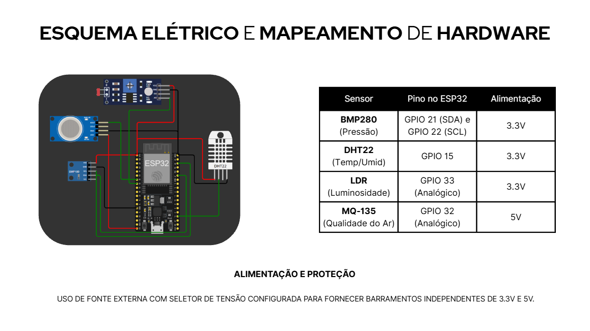
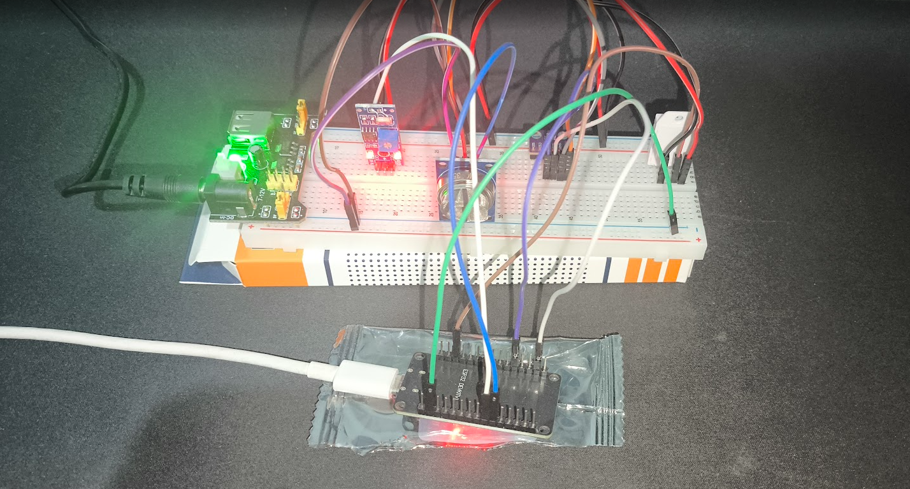

# 🌦️ Estação Meteorológica Inteligente (IoT) — ESP32

🎥 **[ASSISTA AQUI AO VÍDEO TÉCNICO DE DEMONSTRAÇÃO (5-7 MIN)](https://youtu.be/KJiABryaW5s)**

Projeto Integrador desenvolvido para a disciplina **68F3 - Projeto e Desenvolvimento II** (Ciência da Computação — 2º Semestre, UNIP). A solução realiza o monitoramento microclimático urbano em tempo real utilizando arquitetura IoT híbrida (persistência local + nuvem).

---

## 🏗️ Arquitetura da Solução

1. **Coleta (Hardware):** Microcontrolador **ESP32** em MicroPython realizando leitura contínua de 4 sensores ambientais com filtragem de leituras fora de faixa.
2. **Sincronização:** Ajuste automático de data e hora oficial via servidor **NTP**.
3. **Persistência Híbrida:**
   * **Backup Local:** Gravação periódica a cada 30 segundos na memória flash do ESP32 (`banco_dados.csv`) para resiliência contra quedas de Wi-Fi.
   * **Nuvem em Tempo Real:** Envio de pacotes **JSON** via requisições HTTP REST a cada 3 segundos para o **Firebase Realtime Database**.
4. **Visualização (Frontend):** Dashboard web responsivo hospedado no **Netlify** (`estacaoesp32.netlify.app`), exibindo 5 cartões com gráficos SVG dinâmicos, terminal de logs, geolocalização em mapa e alertas críticos.

---

## 🔌 Esquema Elétrico e Pinagem

A alimentação do circuito utiliza uma fonte externa com seletor de tensão configurada para fornecer barramentos independentes de **3.3V** e **5V**, evitando ruídos e oscilações nas leituras.

| Sensor     | Grandezas Medidas              | Pino no ESP32                     | Protocolo         | Alimentação |
| :---       | :---                           | :---                              | :---              | :---        |
| **DHT22**  | Temperatura (°C) e Umidade (%) | `GPIO 15`                         | OneWire / Digital | 3.3V        |
| **BMP280** | Pressão Atmosférica (hPa)      | `GPIO 21 (SDA)` / `GPIO 22 (SCL)` | I2C               | 3.3V        |
| **LDR**    | Luminosidade                   | `GPIO 33`                         | Analógico (ADC)   | 3.3V        |
| **MQ-135** | Qualidade do Ar (PPM)          | `GPIO 32`                         | Analógico (ADC)   | 5V          |

---

## 🚀 Guia de Instalação e Execução

### 1. Firmware (ESP32 + MicroPython)
1. Instale o firmware **MicroPython** no ESP32 e abra o **Thonny IDE**.
2. No arquivo `main.py`, configure as credenciais da sua rede Wi-Fi (`WIFI_CELULAR` e `SENHA_CELULAR`) e a URL do seu banco (`FIREBASE_URL`).
3. Salve os arquivos `main.py` e `banco.py` na raiz da memória flash do ESP32 e execute o `main.py`.

### 2. Dashboard Web
1. Abra o arquivo `index.html` e confirme se a constante `FIREBASE_URL` aponta para o seu Realtime Database.
2. Acesse a interface publicada em: **[https://netlify.app](https://netlify.app)**

---

## 📸 Evidências do Protótipo

### Montagem Física (Bancada)

---

## 👥 Integrantes
* **Gabriel Yuriki Camargo Ota**
* **Luiz Fernando**
